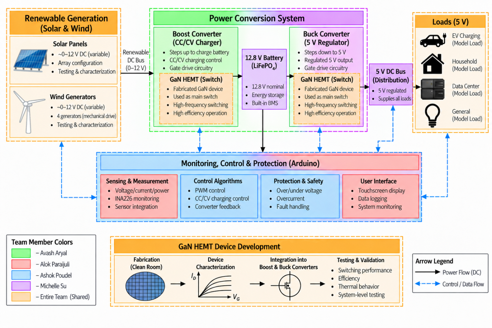
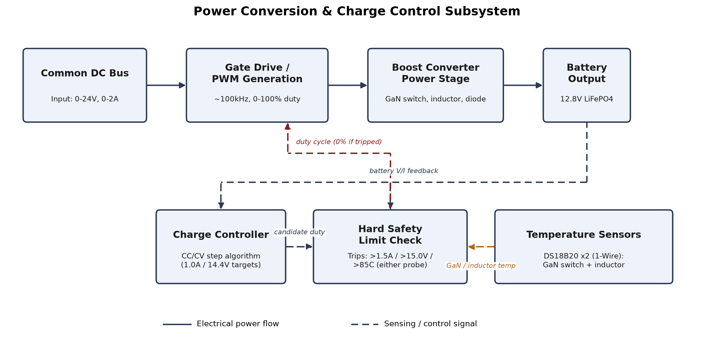
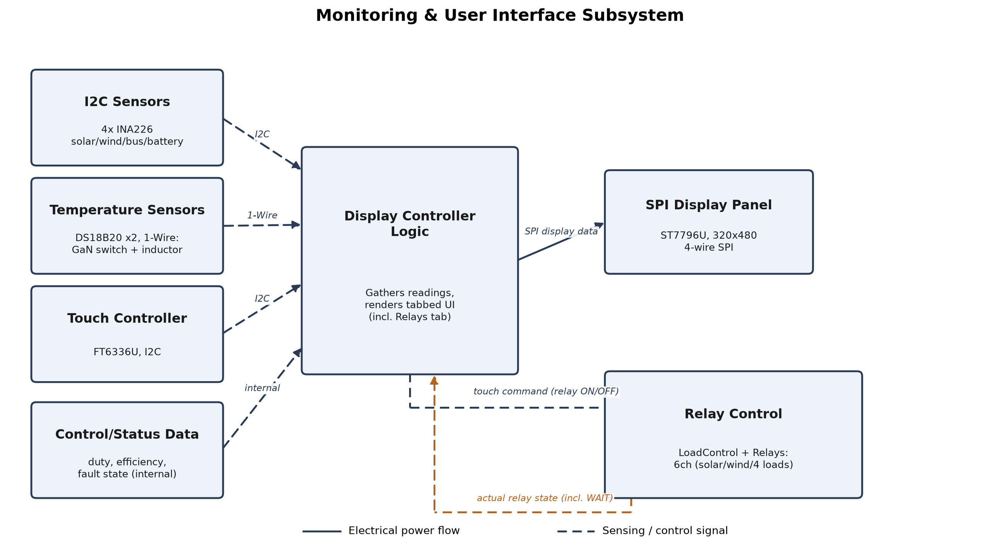

# Ashok Paudel — Subsystem Sections for Product Specification

**Status:** Reworked to match the team's actual approved SOW (`E1.07 – Power Rangers`, v1.2, 09/23/2026) section authorship and feature boundaries, rather than an independently-drawn subsystem split. Three Features are covered here:

- **Feature 2: GaN-Based Boost Converter with CC/CV Battery Charging** — written by Avash Aryal and Ashok Paudel (joint; Avash owns the power-stage hardware design, Ashok contributed the CC/CV control-loop implementation)
- **Feature 3: Real-Time Monitoring and Display** — written by Ashok Paudel (matches the SOW's listed responsibility: "INA226 power monitoring, PWM control, protection, and Arduino/software control development")
- **Feature 4: GaN-Based Buck Converter and 5 V Power Regulation** — written by Ashok Paudel and Avash Aryal (joint, per the SOW)

Plus a draft of **6.4 Safety, Security and Administrative Functions**, and test cases for **Appendix A**. Renumber the `6.x`/`6.y`/`6.z` placeholders to match wherever these land in the final document's section order.

**Note on the controller board:** the SOW (written before hardware bring-up) specifies an Arduino Mega 2560. During bring-up, the Mega exhibited persistent, unresolvable USB/upload failures; the project moved to the **Arduino GIGA R1 WiFi**. This is a real, documented deviation from the SOW, not an inconsistency to be smoothed over — it's described factually in Feature 3 below, where it had the largest technical impact (the PWM-generation approach had to be rebuilt for the new chip).

Also included: **Section 5, System Architecture**, drafted from the SOW's own top-level block diagram (reused directly — it already satisfies the template's requirement to show how the design is partitioned among team members, via its color legend).

---

## 5 System Architecture

*Written by Ashok Paudel and Alok Parajuli, per the SOW.*

### 5.1 Top-Level Block Diagram

The top-level diagram of our system is shown in Figure 1. The system is divided into five main subsystems: wind generation, solar generation, power management and energy storage, monitoring and control, and load distribution. The solar and wind subsystems provide renewable energy input to the CC/CV boost converter, which regulates the power used to charge the LiFePO4 battery. The stored energy is then passed through a buck converter to provide a regulated 5 V DC bus for the model loads. The monitoring and control subsystem measures voltage and current at different points in the system and uses the Arduino to control and monitor the converters and overall system operation.

*Figure 1: Top-Level Block Diagram*

Key inputs to the system are the DC power generated by the solar and wind generation subsystems. The solar array is configured to provide approximately 12 V and up to 1 A under rated conditions, while the four R280 wind generators are designed to provide approximately 2–5 W of combined electrical power. These two renewable power sources are combined and supplied to the power conversion and energy storage subsystem. Key outputs of the system are a regulated 5 V DC supply for the model loads and real-time voltage, current, and power data displayed through the system interface.

**Note:** the diagram's color legend (bottom-left) already shows the required team partitioning — green for Avash Aryal (boost/buck power stages), red for Alok Parajuli (sensing/renewable characterization), blue for Ashok Paudel (monitoring, control, protection), purple for Michelle Su (energy storage/loads), orange for shared/whole-team blocks.

### 5.2 Interface Definition

The system's blocks communicate over a small number of shared buses, each matching a label in Figure 1's "Monitoring, Control & Protection (Arduino)" block:

| Interface | Connects | Purpose |
|---|---|---|
| I2C | INA226 power monitors, touch controller | Reads voltage, current, and power at each sensing point, and touch input for the display |
| 1-Wire | GaN switch and inductor temperature probes | Feeds the thermal protection check |
| 4-wire SPI | Display panel | Drives the touchscreen |
| PWM (gate drive) | Boost and buck converter gate drivers | Commands each converter's switching duty cycle |
| Digital GPIO | Relay module | Switches the solar, wind, and demonstration-load circuits |

Two power domains exist across the system: the Arduino's own 3.3 V logic domain, which carries all the interfaces above, and the higher-voltage power domains (12.8 V battery, 5 V load bus) shown as solid lines in Figure 1. The two meet only where a control signal deliberately crosses between them, such as the PWM gate-drive signal, which reaches the higher-voltage gate driver through a dedicated driver IC built for that purpose.

*(Implementation-level detail — which exact timer generates each PWM signal, opto-isolation specifics, etc. — lives in each Feature's own Interface section below, not here; this section stays at the system block-diagram level.)*

---

## 6.2 Feature 2: GaN-Based Boost Converter with CC/CV Battery Charging

*Written by Avash Aryal and Ashok Paudel.*

### 6.2.1 Design Analysis

#### 6.2.1.1 Objective

This subsystem regulates the variable DC power arriving from the solar and wind sources on the common DC bus, boosts it, and charges a 12.8 V LiFePO4 battery using a constant-current/constant-voltage (CC/CV) profile: 1.0 A constant current until the battery reaches 14.4 V, then holding 14.4 V while current tapers. The power stage (GaN switching device, inductor, diode, gate driver) was designed by Avash Aryal; the CC/CV control-loop firmware that decides what duty cycle to command, and the independent hard-limit protection that overrides it regardless of what the algorithm requests, were implemented by Ashok Paudel.

#### 6.2.1.2 Evaluation Criteria

| Criterion | Why it matters |
|---|---|
| Control loop stability | Must reach and hold CC/CV targets without destructive oscillation or overshoot |
| Fault coverage independent of control mode | A bug in the control algorithm must not be the only thing standing between the circuit and an overvoltage/overcurrent event |
| Component selection for the power stage | Switching device, inductor, and diode must support ~100 kHz operation at the target power level |
| Code maintainability | Control logic must be testable independently of the PWM-generation mechanism underneath it |

#### 6.2.1.3 Design Alternatives

1. **Control algorithm:** a full PID controller vs. a simple incremental step controller (step duty cycle up/down by a fixed amount each control tick, based on whether current/voltage are above or below target).
2. **Switching device:** GaN HEMT (Renesas TP65H150G4PS) vs. a conventional silicon MOSFET.
3. **Boost diode:** Schottky (1N5822) vs. a standard silicon rectifier.

#### 6.2.1.4 Comparative Analysis and Conclusion

**Control algorithm:** The step controller was chosen over a full PID for this first working version. It has no proportional or derivative term, so it responds slowly and predictably rather than reacting hard to sudden sensor noise — a deliberate choice for safety while testing unvalidated hardware. It is also easy to reason about and tune, with one step-size constant. The architecture separates "decide what duty cycle" (`ChargeController`) from "safely apply whatever duty cycle it's told" (`BoostConverter`) — see Feature 3 for the PWM-generation mechanism itself, which is where the project's most significant technical problem (duty-cycle resolution) actually lived, not in this control algorithm.

**Switching device:** GaN was selected over silicon for its lower switching losses and higher achievable switching frequency at this power level, consistent with the project's wide-bandgap-semiconductor research goals (this project serves as a testbed for Texas State's UWBG Power Converter research initiative).

**Boost diode:** A Schottky diode (1N5822, 3 A) was chosen for its low forward-voltage drop and fast recovery time at the ~100 kHz switching frequency, where a standard silicon diode's slower reverse-recovery behavior would introduce unacceptable switching losses.

### 6.2.2 Block Diagram

*Figure X: GaN-Based Boost Converter with CC/CV Battery Charging — Block Diagram*

*As shown in Figure X, this subsystem takes the common DC bus voltage/current as its electrical input and the battery's measured voltage/current as its control feedback, producing a PWM gate-drive signal as its only electrical output. The control chain mirrors the firmware's own call order: the Charge Controller computes a candidate duty cycle from the CC/CV algorithm, and the Hard Safety Limit Check (Feature 3) has the final say — it can override that candidate to 0% if voltage, current, or either temperature probe exceed the absolute limits, regardless of what the Charge Controller requested.*

### 6.2.3 Interface

**Inputs**

| Input | Source | Min | Max | Description |
|---|---|---|---|---|
| Common DC bus power | Solar + wind branches, combined after isolation diodes | 0 V / 0 A | ~24 V / 2 A (2S4P expansion case) | Variable renewable DC input to the boost converter |
| Battery feedback (voltage, current) | Battery-side INA226 sensor, via I2C | 0 V / 0 A | 36 V / 2 A (sensor configured range) | Closed-loop feedback used by the CC/CV algorithm |

**Outputs**

| Output | Destination | Min | Max | Description |
|---|---|---|---|---|
| Candidate duty cycle | Hard Safety Limit Check (Feature 3) | 0% | 80% (CC/CV ceiling, independent of the hardware's own 0-100% clamp) | The CC/CV algorithm's requested duty cycle, before the independent safety override |
| Regulated charge output | 12.8 V LiFePO4 battery | 0 V / 0 A | 15.0 V / 1.5 A (hard safety limit); target 14.4 V / 1.0 A | CC/CV-regulated charging current/voltage |

---

## 6.3 Feature 3: Real-Time Monitoring and Display

*Written by Ashok Paudel.*

### 6.3.1 Design Analysis

#### 6.3.1.1 Objective

This is the subsystem that actually generates the PWM signals driving both the boost and buck converters' gate drivers, enforces safety limits independently of whatever any control algorithm requests, reads all system sensors (power and temperature), and presents that information on a touchscreen display — matching the SOW's listed responsibility: "INA226 power monitoring, PWM control, protection, and Arduino/software control development." It also provides touch-driven control of six relay-switched circuits (solar array, wind subsystem, and four demonstration loads), with an automatic power-availability check that can hold a load relay off even when the operator has requested it on.

#### 6.3.1.2 Evaluation Criteria

| Criterion | Why it matters |
|---|---|
| Achievable PWM switching frequency (~100 kHz target) and duty-cycle resolution | Matches the boost/buck converters' component selection; determines how finely any control loop built on top can hold its targets |
| Fault coverage independent of control mode | A bug in either converter's control algorithm must not be the only thing standing between the circuit and an overvoltage/overcurrent/overtemperature event |
| Measurement range and accuracy | Must cover the project's 0–2 A operating range with enough resolution to be useful |
| I2C address availability | Up to 5 devices (4 active INA226 sensors + touch controller) share one bus without address collisions |
| Display readability and touch reliability | Values must be legible at demo distance; tap targets must be reliably distinguishable from accidental touches |
| Separation from control-algorithm logic | PWM generation, protection, and display code should each be testable independent of whatever control algorithm (boost CC/CV, buck CV) is driving them |

#### 6.3.1.3 Design Alternatives

1. **PWM generation method:** the microcontroller's built-in `analogWrite()` vs. direct configuration of a hardware timer's registers.
2. **Target microcontroller board:** Arduino Mega 2560 (per the SOW) vs. Arduino GIGA R1 WiFi.
3. **Sensor library:** a general-purpose INA226 Arduino library (e.g., Adafruit's) vs. a library exposing explicit shunt-resistor and current-range calibration (INA226_WE).
4. **Display driver library:** the display manufacturer's bundled demo library vs. a community-maintained Adafruit-compatible driver.
5. **Screen layout:** a single screen showing all values at once vs. a tabbed interface showing one category at a time.
6. **Relay control model:** fully automatic (sensor-driven) switching vs. touch-initiated switching with an automatic power-availability override.

#### 6.3.1.4 Comparative Analysis and Conclusion

**PWM generation method:** `analogWrite()` tops out around 490–980 Hz, far short of the ~100 kHz target, so direct timer configuration was used instead. AVR gives 160 steps (~0.625% each); the Giga's TIM8 gives 2,400 (~0.042%). Mbed's standard PWM API was tried first but measured only ~10% steps on the scope, which is why direct register control was needed.

**Microcontroller board:** the Mega 2560 (SOW's original target) had persistent upload failures that troubleshooting couldn't resolve, so the project moved to the Giga R1 WiFi (STM32H7), requiring the PWM code to be ported since AVR registers don't apply. 100 kHz and ~0.042% resolution are confirmed on the Giga. The change only touched the PWM module — everything else was unaffected, validating the modular design.

**Sensor library:** INA226_WE was chosen for its explicit shunt-resistor and current-range calibration, needed for accurate readings at the project's 0.010 Ω shunt and 0–2 A range.

**Display driver library:** the bundled LCDWIKI demo library was rejected after user reports of outdated, compile-breaking code. `Adafruit_ST7796S_kbv` was used instead, based on a verified-buyer report confirming it works on a Mega2560 with this exact panel.

**Screen layout:** a tabbed interface (8 tabs) was chosen over one dense screen, keeping readings legible at a large size while limiting touch targets to one row of tabs.

**Relay control model:** touch-initiated switching was chosen over full automation, except the 4 demo loads, which add an automatic power-availability veto — same layered pattern as the hard safety limits overriding manual duty cycle. This keeps a human in the loop while still demonstrating automatic load-shedding.

### 6.3.2 Block Diagram

*Figure Y: Real-Time Monitoring and Display — Block Diagram*

*As shown in Figure Y, this subsystem's inputs are the sensor readings and touch input, not the physical sensors themselves — those are wired per Feature 1/Feature 5's design but read and interpreted here. The Control/Status Data input represents the candidate duty cycle and fault state fed in from Feature 2's CC/CV algorithm, which this subsystem's own Hard Safety Limit Check can override. The Relay Control block is bidirectional: touch commands flow out to it, and its actual relay state (including a third "WAIT" state when a load is requested on but held off by the power-availability check) flows back for display.*

### 6.3.3 Interface

**Inputs**

| Input | Source | Min | Max | Description |
|---|---|---|---|---|
| I2C sensor data | 4 active INA226 modules (solar, wind, common bus, battery) + 1 reserved placeholder address | 0 V / 0 A | 36 V / 2 A (configured range) | Voltage/current/power, polled over the shared I2C bus |
| Temperature data | 2x DS18B20 probes, 1-Wire | Ambient | 85°C trip point | GaN switch and boost inductor temperatures |
| Touch input | FT6336U capacitive touch controller, I2C + dedicated reset/interrupt lines | — | — | Single-touch coordinates, used for tab selection and relay button taps |
| Candidate duty cycle | Feature 2's CC/CV algorithm | 0% | 80% | Subject to override by this subsystem's hard safety limit check |

**Outputs**

| Output | Destination | Min | Max | Description |
|---|---|---|---|---|
| Gate-drive PWM signals | TC4427 gate drivers (boost and buck) | 0% duty | 100% duty (clamped) | ~100 kHz PWM; the only mechanism by which either converter's switching device is actually driven |
| Display data (4-wire SPI) | ST7796U display controller | — | — | Renders the tabbed UI: per-category readings, duty/efficiency, fault status, and relay button states |
| Relay switching commands | 6-channel relay module (solar, wind, 4 demo loads) | 0 (de-energized) | 1 (energized) | Operator intent, gated by the automatic power-availability check for the 4 load relays |

---

## 6.4 Feature 4: GaN-Based Buck Converter and 5 V Power Regulation

*Written by Ashok Paudel and Avash Aryal.*

### 6.4.1 Design Analysis

#### 6.4.1.1 Objective

This subsystem steps the 12.8 V battery output down to a regulated 5 V DC bus supplying the model loads (data center, EV charging, LED lamp, and other demonstration loads). Unlike Feature 2's CC/CV battery charging, this is primarily constant-voltage regulation with a current ceiling: the converter's normal job is holding 5.0 V regardless of load, with an automatic override that caps total current if connected loads try to draw more than the design allows.

#### 6.4.1.2 Evaluation Criteria

| Criterion | Why it matters |
|---|---|
| Output voltage regulation | Must hold 5.0 V across the expected load range without a separate control loop per load |
| Current ceiling matched to real component ratings | The ceiling must reflect what the actual power-stage components (diode, inductor) can safely deliver, not an assumed figure |
| Gate-drive timer independence from the boost converter | Driving a second GaN switch must not risk interfering with Feature 2's already-validated PWM generation |

#### 6.4.1.3 Design Alternatives

1. **Topology validation method:** hand-calculated component estimates vs. LTspice simulation before committing to real parts.
2. **Rectifying diode:** the originally-simulated 1N5819 (1 A) vs. a higher-current Schottky already used elsewhere in the system (SB540, 5 A).
3. **Gate-drive timer:** sharing the boost converter's TIM8 peripheral (different channel) vs. a fully separate timer (TIM1).

#### 6.4.1.4 Comparative Analysis and Conclusion

**Topology validation:** the buck converter's design was validated in LTspice before any component was ordered, rather than relying on hand-calculated estimates as an initial placeholder had done. The simulated circuit (12 V input, EPC2204 GaN switch, 47 µH inductor, 220 µF output capacitor, 1N5819 diode, 100 kHz switching at a fixed 41.7% duty cycle) settled to ~4.7–4.8 V output at ~0.95 A into a 5 Ω test load — consistent with the ideal buck relationship (Vout ≈ Vin × D) and confirming the topology and component values before committing to real hardware.

**Rectifying diode:** the simulated 1N5819 is rated for only ~1 A forward current. The real system's calculated total current ceiling — EV charger (~1 A) + data center (~0.25 A) + LED lamp (~0.15 A) + other (~0.2 A) = 1.6 A, rounded to 2.0 A for margin (the same ~50% headroom pattern as Feature 2's hard current limit over its CC target) — exceeds what the simulated diode can safely deliver. The SB540 (5 A/40 V), already used elsewhere in this project for the solar/wind isolation diodes, was selected as the replacement: comfortable margin above the 2.0 A ceiling, and one fewer new part type to source.

**Gate-drive timer:** rather than share Feature 2's TIM8 peripheral (a different channel of the same physical timer), a separate timer (STM32's TIM1) was selected to keep this subsystem's PWM generation fully independent — avoiding any risk of this converter's initialization code interfering with Feature 2's already-validated TIM8 configuration, consistent with this project's broader pattern of keeping subsystems' hardware ownership non-overlapping. The exact GPIO pin/alternate-function mapping for TIM1 Channel 2 has not yet been confirmed against the Giga's official pinout (only a third-party reference), and is pending bench verification via a standalone test sketch before integration — the same verification discipline that caught Feature 3's PWM-resolution problem rather than trusting documentation alone.

### 6.4.2 Interface

**Inputs**

| Input | Source | Min | Max | Description |
|---|---|---|---|---|
| Battery output | 12.8 V LiFePO4 battery (Feature 2's output) | 0 V / 0 A | 15.0 V / 1.5 A | The buck converter's input rail |
| Output voltage feedback | Load-bus INA226 sensor | 0 V | 36 V (sensor configured range) | Closed-loop feedback for the CV regulation target |

**Outputs**

| Output | Destination | Min | Max | Description |
|---|---|---|---|---|
| Gate-drive PWM signal | Dedicated TC4427 gate driver (buck stage) | 0% duty | 100% duty (clamped) | ~100 kHz PWM, generated via STM32 TIM1 (pending pin verification) |
| Regulated 5 V load bus | Model loads (data center, EV charging, LED lamp, other) | 0 V / 0 A | 5.0 V / 2.0 A (calculated ceiling) | CV-regulated, with automatic current-ceiling override — not a symmetric CC/CV profile like Feature 2's battery charging |

---

## 6.6 Safety, Security and Administrative Functions

*Drafted by Ashok Paudel, since Feature 3 contains the project's safety-critical PWM and protection logic.*

**Safety:** Both GaN converters (boost, Feature 2; buck, Feature 4) can be commanded by either an automatic control algorithm or a manual bench-test mode. All modes share one independent hard-limit check, implemented in Feature 3: if battery voltage exceeds 15.0 V, current exceeds 1.5 A, or either temperature probe (GaN switch, boost inductor) exceeds 85°C, the boost converter's output is immediately forced to 0% duty cycle, regardless of which mode commanded the unsafe value. This exists specifically because manual test mode has no other protection: a person typing a duty-cycle value by hand has nothing else stopping an unsafe command from reaching the gate driver. The buck converter (Feature 4) carries an analogous current-ceiling override, capping output current at 2.0 A regardless of load demand.

Two further automatic-mode checks protect against conditions the control algorithm alone cannot detect: (1) if the battery sensor stops responding on I2C, the system cannot distinguish "no feedback" from "feedback reading zero," so it treats a missing sensor as an immediate fault; (2) if duty cycle is pinned at its ceiling for more than 3 seconds without reaching the target charging current, this is treated as a likely open-circuit or disconnected-battery condition.

All faults **latch**: once tripped, the output stays forced to 0% and does not auto-retry, even if the triggering condition later goes away on its own. Clearing a fault requires a manual reset (power cycle or reset button). In manual test mode, any typed duty-cycle command is refused outright once a fault is latched, so a bench operator cannot accidentally override the safety trip.

**Relay safety:** the six relay-switched circuits (solar array, wind subsystem, and four demonstration loads) are deliberately scoped to exclude anything the charge controller needs to stay connected to function (e.g. battery-to-charger) or that is meant as a human bench-test disconnect (e.g. overall system master power, which cannot be relay-controlled by the Arduino it powers without creating a self-disconnect paradox). Relay channel assignment keeps the Giga's GPIO pins only ever driving the relay module's opto-isolated logic input, never carrying relay-coil current directly.

**Administrative functions:** the choice between manual test mode and automatic charging mode is a compile-time setting (`MANUAL_PWM_TEST_MODE` in the firmware configuration), not a runtime option. Changing it requires re-uploading the firmware — a deliberate restriction functioning as an implicit access control over this debug capability.

**Security:** this subsystem does not store user accounts, credentials, or personally identifiable data. A read-only local-network status dashboard (hosted by the Giga's own WiFi hardware) is planned but not yet implemented in firmware; relay control is deliberately excluded from that dashboard's scope and remains touchscreen-only, so no network-originated command can switch power on this system. The touchscreen itself has no administrative login; all sensor readings and fault status are read-only to the user, and the only "write" actions available at the display are tab navigation and the six relay buttons, bounded by the safety scoping described above.

---

## Appendix A Test Cases — Features 2, 3, and 4

*Procedures below are adapted from the working test procedures in `Bench Tests/`. "Overall Results" is marked "Could not be completed" for anything not yet run on hardware.*

### Test Plan Overview

*Matches the official template's required format: grouped by subsystem, with a Designated Responsible Individual (DRI) per test, plus a minimum of 3 whole-system integration tests. The integration tests below are drafted from Ashok's side of the system (Features 2-4) — they necessarily touch Feature 1 (solar/wind) and Feature 5 (energy storage/loads) too, so confirm DRI/ownership with the whole team before submitting.*

**Feature 3 (Real-Time Monitoring and Display) Subsystem Unit Tests**

| # | Test | DRI |
|---|---|---|
| 1 | 100 kHz PWM Frequency and Duty-Cycle Verification | Ashok Paudel |
| 2 | Hard Safety Limit Trip Test | Ashok Paudel |
| 3 | INA226 Sensor Accuracy Verification | Ashok Paudel |
| 4 | Touch Tab Navigation and Relay Control Test | Ashok Paudel |

**Feature 4 (GaN-Based Buck Converter and 5 V Power Regulation) Subsystem Unit Tests**

| # | Test | DRI |
|---|---|---|
| 1 | Buck Converter Output Voltage and Current-Ceiling Verification | Ashok Paudel and Avash Aryal |

**Overall System Integration Tests** *(minimum 3 required by the template — these are drafted candidates, not yet confirmed with the full team)*

| # | Test | DRI |
|---|---|---|
| 1 | Combined solar + wind input successfully boosts and charges the battery, confirmed live on the touchscreen display | *(needs team confirmation — spans Feature 1, 2, 3)* |
| 2 | Battery powers the 5 V load bus via the buck converter when renewable sources are inactive, confirmed on the display | *(needs team confirmation — spans Feature 2, 4, 5)* |
| 3 | An overtemperature or overcurrent fault on the boost converter immediately disables output and is visible on the Status tab within the same second | *(needs team confirmation — spans Feature 2, 3)* |

### A.y.1 100 kHz PWM Frequency and Duty-Cycle Verification

| Test y.1 | Written by: Ashok Paudel |
|---|---|
| Subsystem: Feature 3 (Real-Time Monitoring and Display) | Tested by: *(pending)* |
| Equipment Required: Oscilloscope with 10x probe, Arduino GIGA R1 WiFi with test sketch loaded, USB cable | |
| Description: Confirms the boost converter's gate-drive PWM output runs at the design target of 100 kHz, and that typed duty-cycle commands (0–100%) produce the expected, distinguishable output duty cycles. | |
| Overall Results: **PASS** — frequency and duty-cycle resolution both confirmed | |

| # | Procedure | Expected Result | Actual Result | Comments |
|---|---|---|---|---|
| 1 | Probe the gate-drive pin with the board running the manual PWM test sketch; measure period with the oscilloscope | 100 kHz (10 µs period) | 100.01–100.02 kHz measured | Passed |
| 2 | Type 25, 26, 27, 28, 29, 30 into Serial Monitor; measure duty cycle at each | Each value visibly distinct | Initial Mbed `PwmOut`-based implementation floored every value to the nearest 10%; traced to Mbed's PWM API itself. Replaced with direct STM32 TIM8 register control (240MHz clock, 2400 steps/period); retested at 35%, 55%, 58%, confirmed correct | Passed after the TIM8 rework; see §6.3.1.4 |

### A.y.2 Hard Safety Limit Trip Test

| Test y.2 | Written by: Ashok Paudel |
|---|---|
| Subsystem: Feature 3 (Real-Time Monitoring and Display) | Tested by: *(pending)* |
| Equipment Required: Current-limited bench power supply, multimeter, battery-side INA226 sensor wired and powered | |
| Description: Confirms that battery voltage exceeding 15.0 V, or current exceeding 1.5 A, immediately forces the boost converter's gate-drive output to 0% duty and latches a fault, in both automatic and manual operating modes. | |
| Overall Results: **Could not be completed** — not yet run on hardware | |

| # | Procedure | Expected Result | Actual Result | Comments |
|---|---|---|---|---|
| 1 | With duty cycle at 0%, apply 15.5 V to the battery sensor's bus terminals from the bench supply | Fault message appears within ~50 ms; duty forced to 0% | | |
| 2 | Lower supply voltage back below the limit without resetting the board | Fault remains latched (does not auto-clear) | | |
| 3 | Reset the board | Fault clears; normal operation resumes | | |

### A.y.3 INA226 Sensor Accuracy Verification

| Test y.3 | Written by: Ashok Paudel |
|---|---|
| Subsystem: Feature 3 (Real-Time Monitoring and Display) | Tested by: *(pending)* |
| Equipment Required: Digital multimeter, bench power supply, known 1 kΩ precision load resistor | |
| Description: Confirms each INA226 sensor's reported voltage and current match independent multimeter measurements within tolerance, for a known applied voltage and load. | |
| Overall Results: **Could not be completed** — not yet run on hardware | |

| # | Procedure | Expected Result | Actual Result | Comments |
|---|---|---|---|---|
| 1 | Apply 12.00 V across a sensor's bus terminals from the bench supply; compare multimeter and sensor-reported voltage | Within ±1% or ±0.05 V | | |
| 2 | Connect 1 kΩ load; compare multimeter and sensor-reported current (expected 12 mA) | Within ±2% or ±5 mA | | |

### A.y.4 Touch Tab Navigation and Relay Control Test

| Test y.4 | Written by: Ashok Paudel |
|---|---|
| Subsystem: Feature 3 (Real-Time Monitoring and Display) | Tested by: *(pending)* |
| Equipment Required: Assembled display/touch panel, Arduino GIGA R1 WiFi with firmware loaded, relay module wired | |
| Description: Confirms that tapping each tab switches to the corresponding category, taps below the tab bar have no effect except on the Relays tab, and relay buttons reflect ON/OFF/WAIT state correctly. | |
| Overall Results: **Could not be completed** — display, touch controller, and relay module not yet verified on real hardware | |

| # | Procedure | Expected Result | Actual Result | Comments |
|---|---|---|---|---|
| 1 | Tap each tab in turn | Active tab highlights; correct category's values display | | |
| 2 | Tap within the content area on a non-Relays tab | No change occurs | | |
| 3 | On the Relays tab, tap the Solar and Wind buttons | Each toggles directly between grey (OFF) and green (ON) — no WAIT state possible | | |
| 4 | On the Relays tab, tap a load button while battery power is below the configured threshold | Button shows yellow "WAIT", relay does not energize | | |
| 5 | Repeat with battery power above the threshold | Button shows green "ON", relay energizes | | |

### A.z.1 Buck Converter Output Voltage and Current-Ceiling Verification

| Test z.1 | Written by: Ashok Paudel and Avash Aryal |
|---|---|
| Subsystem: Feature 4 (GaN-Based Buck Converter and 5 V Power Regulation) | Tested by: *(pending)* |
| Equipment Required: Oscilloscope, electronic/resistive load bank, multimeter, Arduino GIGA R1 WiFi with buck converter firmware loaded | |
| Description: Confirms the buck converter holds 5.0 V across a range of light loads, and that total output current is capped at 2.0 A (with the SB540 diode substitution) rather than the 1 A the originally-simulated 1N5819 would have limited it to. | |
| Overall Results: **Could not be completed** — buck converter firmware and gate-drive pin not yet bench-verified | |

| # | Procedure | Expected Result | Actual Result | Comments |
|---|---|---|---|---|
| 1 | Apply a light load (e.g. 200 mA) to the 5 V bus; measure output voltage | 5.0 V ± regulation tolerance | | |
| 2 | Increase load toward 2.0 A combined; measure output voltage and current | Voltage holds near 5.0 V until current approaches 2.0 A, then current ceiling engages and voltage sags | | |
| 3 | Verify no load can pull current beyond ~2.0 A regardless of how low output voltage sags | Current stays capped | | |

---

## Notes for Whoever Reviews This

- Both block diagrams are generated figures (`media/power-conversion-block-diagram.png`, `media/monitoring-ui-block-diagram.png`), drawn from a script rather than by hand. Check the figure numbers (currently placeholder "Figure X" / "Figure Y") match the actual numbering once merged into the full document. Feature 4 (buck converter) does not yet have its own diagram — worth adding one before final submission.
- This draft now matches the SOW's actual Feature/authorship boundaries (Feature 2 = Avash + Ashok, Feature 3 = Ashok, Feature 4 = Ashok + Avash), rather than an independently-drawn two-subsystem split. Confirm with Avash before submitting, since his half of Feature 2 and Feature 4 is written here from Ashok's side of the collaboration, not independently reviewed by him yet.
- Trade-study evaluation criteria and comparative analysis are written from the actual design history of this project; adjust wording/weighting if your advisor wants a more formal scored-criteria table rather than prose.
- All "Could not be completed" results should be updated with real data as bench testing proceeds — see `Bench Tests/06-Test-Log.md`, the live source of truth for test results.
- The buck converter's current ceiling (2.0 A) and the SB540 diode substitution are both recent (this week) design decisions, not yet validated on real hardware or re-simulated in LTspice with the new diode — flagged honestly in §6.4.1.4, not glossed over.
